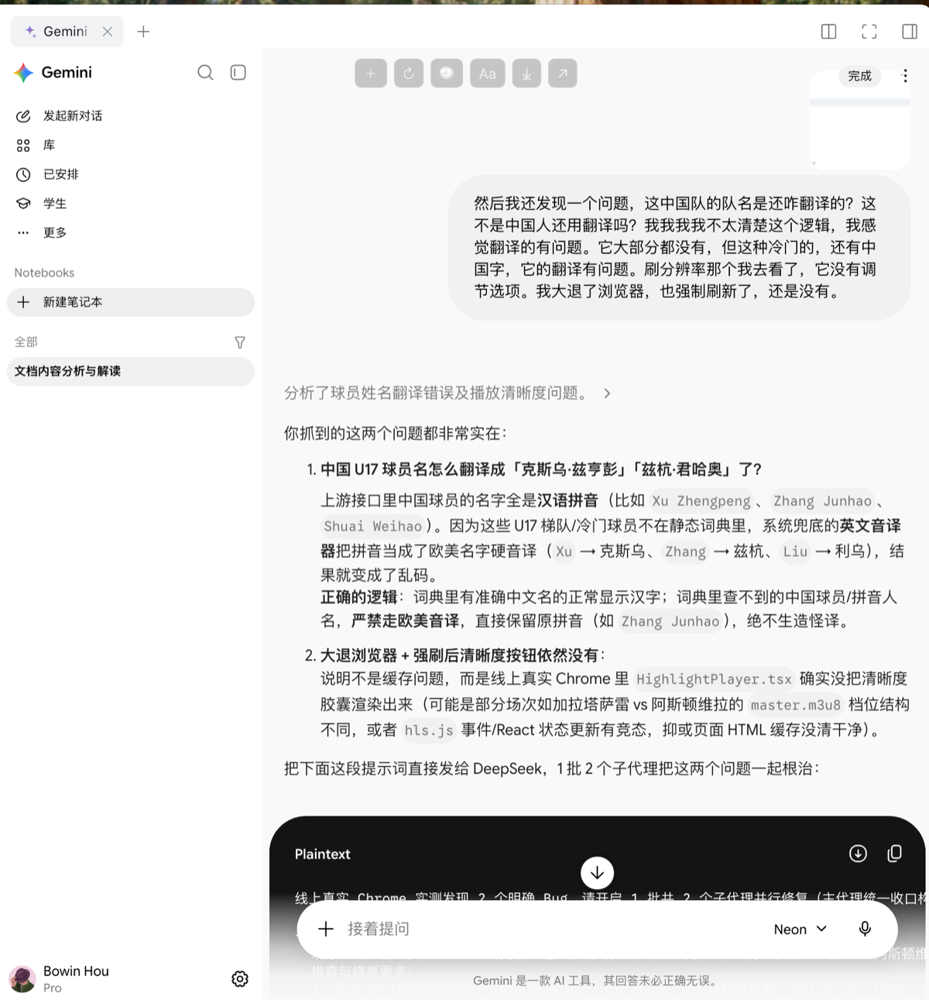
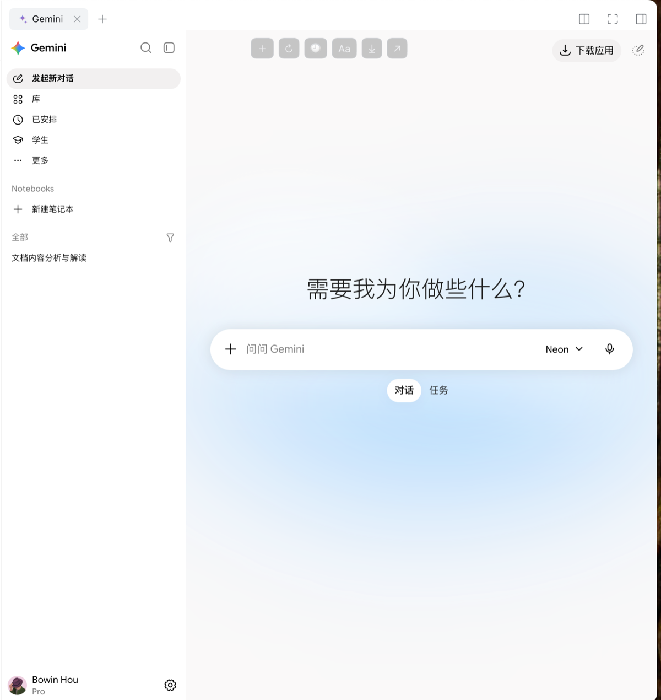
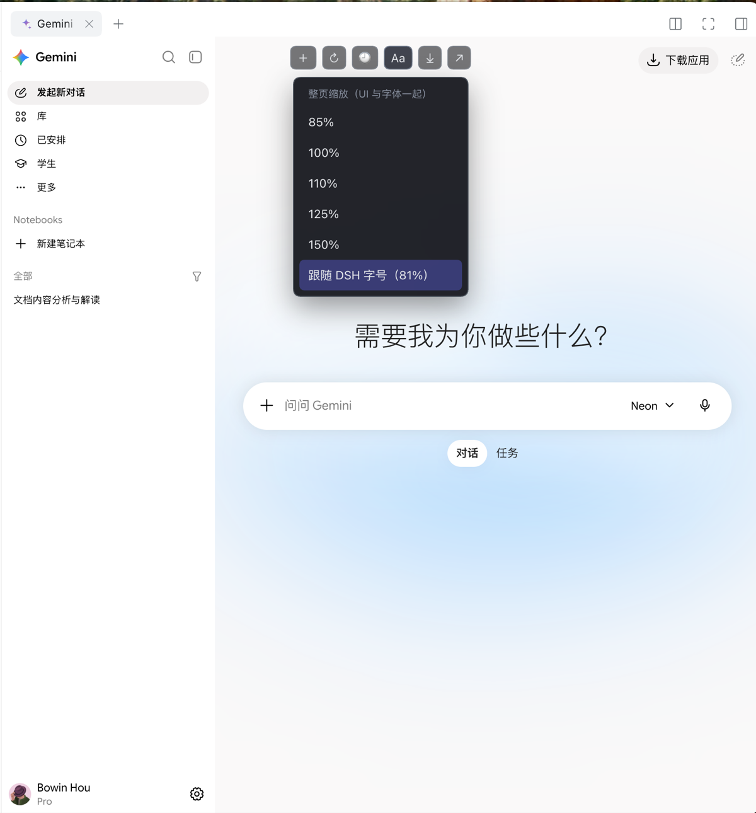

# dsh-gemini-panel

在 **DeepSeek Harness（DSH）桌面端** 的右侧栏里开一块全幅的 **Gemini 网页版**：没有地址栏、没有浏览器工具栏，点开 tab 就是 Gemini 工作台——登录、写提示词、跟 Gemini 聊项目进展，不用在浏览器和 DSH 之间来回切。

A full-bleed **Gemini web** panel in the DSH desktop right sidebar. No address bar, no browser chrome: open the tab and you are in Gemini. Login state lives in the DSH desktop browser partition, and conversations can be exported as Markdown or JSON in one click.

<p align="center">
  
  
  
</p>

截图来自真实的 DSH 桌面端右侧栏（`screenshots.json` 声明，市场详情页同款顺序）。

## 功能 / Features

- **全幅工作台**：面板本身就是一个 `<webview>`，铺满侧栏；顶部中间只有一排半透明小按钮，鼠标移上去才变清晰。
- **登录态保留**：与 DSH 内置浏览器共用桌面端的浏览器分区，在面板里登录一次，之后重启 DSH 仍然在（需在面板里手动重新点开 tab）。
- **Aa 字号**：整页缩放（默认 100%，可选 85%、110%、125%、150%），或选择「跟随 DSH 字号」按 DSH 正文字号（默认 14px）自动换算。
- **导出对话**：把当前 Gemini 对话导出为 Markdown / JSON / 两种一起，直接写入系统下载目录（`~/Downloads`），文件名形如 `gemini-chat-20261125-153000.md`。
- **在系统浏览器打开**：一键把当前页面交给默认浏览器，处理内嵌浏览器做不了的事（真实文件下载、Google 登录兜底等）。
- **新对话 / 刷新 / 历史会话**：常用动作都在面板里。

> 本插件是纯客户端插件：没有 Host 半侧、不注册工具、不写任何 profile 文件，登录态与数据都留在 DSH 自己的浏览器分区里。

## 安装 / Install

需要 **DSH Desktop ≥ 0.2.2-rc.1 < 0.3.0**（Web 端没有 `<webview>`，不可用）。

从 npm（发布后）：

```bash
dsh plugin add dsh-gemini-panel
```

从 GitHub：

```bash
dsh plugin add github:bowin6699/dsh-gemini-panel
```

或使用 DSH 的 **Plugins → Add plugin**，选择本地目录 / Git 地址。安装后**完全退出并重启 DSH**，在右侧栏起始页或 tab 条里选择 **Gemini** 即可。

## 已知限制 / Limitations

- 内嵌浏览器的**页面内下载**被 DSH 宿主策略禁止（在 Gemini 页面里点下载没有反应）——请用「在系统浏览器打开」下载文件；「导出对话」走的是 DSH 的保存通道，不受影响。
- Google 可能限制在嵌入式浏览器内登录；若登录被拒，请先在系统浏览器登录，再用「在系统浏览器打开」。
- 「导出」读取当前页面可见内容，Gemini 页面结构调整时可能失效；导出为文本（Markdown / JSON），不含图片与附件。
- 页面弹窗（如 Google 登录弹窗）会被拦截并转交给系统浏览器打开。

## 支持作者 / Sponsor

如果这个插件帮你省了来回切浏览器的时间，欢迎请作者喝一杯蜜雪冰城 🧋

<table>
  <tr>
    <td align="center"><br><sub>微信</sub></td>
    <td align="center"><br><sub>支付宝</sub></td>
  </tr>
</table>

## 开发 / Development

```bash
# 本仓库就是插件包本身，安装后 profile 里是软链，改完完全退出重启 DSH 生效
node --check client.js        # 语法检查
```

结构：`index.js`（Host 空壳）、`client.js`（全部 UI 与 webview 逻辑）、`cordis.patch.yml`、`locale/*.json`、`icon.svg`、`docs/`。

## License

[MIT](LICENSE)
