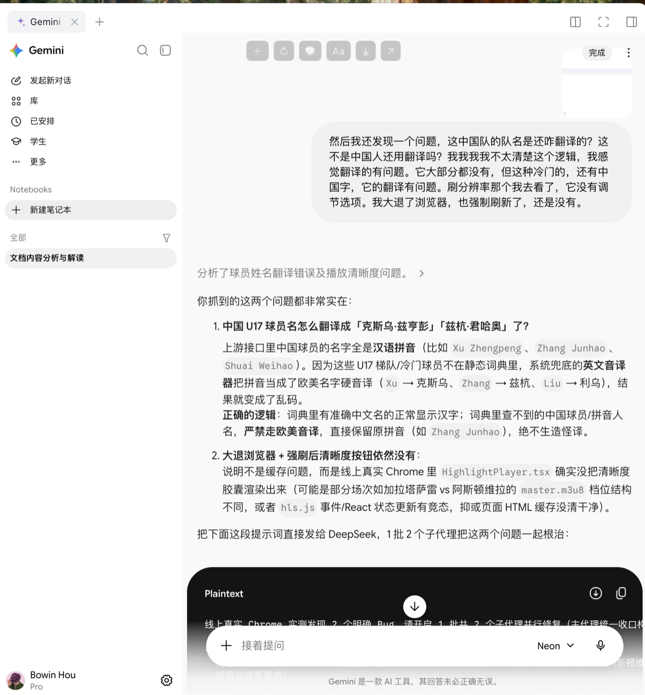
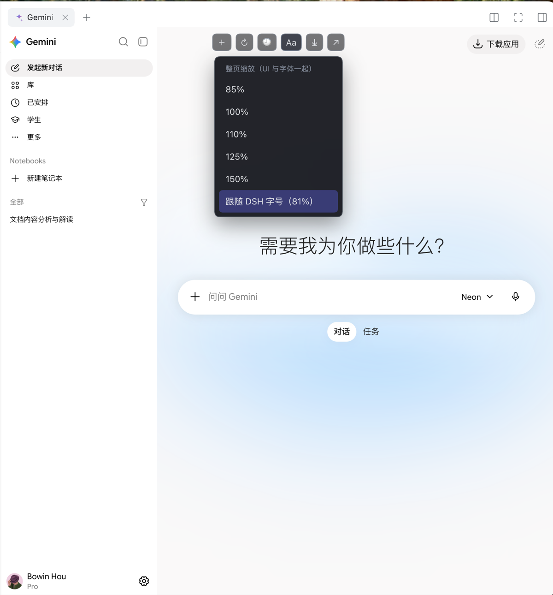

# Gemini 面板（dsh-gemini-panel）

在 DSH 桌面端右侧栏中打开一块**全幅的 Gemini 网页版**（`https://gemini.google.com/`）：没有地址栏、没有刷新栏，点开 tab 就是 Gemini 工作台，用来登录、写提示词、和 Gemini 沟通项目进展。

## 形态

- 一个独立的右侧栏 tab（`Gemini`），每个会话一份；切换会话时面板保留挂载（不重新加载），关闭 tab 时释放。
- 页面本体是 Electron `<webview>`，通过 DSH 桌面壳公开的 `dshDesktop.browser` 租约接口创建，与官方内置浏览器共用同一套安全策略与存储分区（因此也共享登录态）。
- 入口同时注册为起始页卡片（better-sidebar 接管起始页后仍会显示）与 tab 类型，可用侧栏起始页打开。

## 界面

全幅页面，右上角有半透明小按钮（鼠标移入时变清晰）：

- **＋ 新对话**：在 Gemini 内开启新对话（找不到按钮时回退为重新载入 `/app`）。
- **↻ 刷新**：重新载入当前页面。
- **🕘 历史会话**：尝试打开 Gemini 自己的历史会话入口。
- **Aa 字号**：整页缩放（页面文字与 UI 一起放大/缩小），可选 85% / 100% / 110% / 125% / 150%，或选择「跟随 DSH 字号」自动按 DSH 的正文字号（默认 14px）换算缩放比例；选择会记住。
- **导出**：下拉选择导出 Markdown、JSON，或两种格式一起保存；文件由 DSH 的保存通道直接写入系统下载目录。
- **↗ 在系统浏览器打开**：把当前页面交给默认浏览器（那边的登录态本来就存在）。

页面上的弹窗（如 Google 登录弹窗）会被拦截并转交系统浏览器打开。

## 限制

- 仅桌面端（DSH Desktop）可用；Web 端无 `<webview>`，面板会显示不可用提示。
- 内嵌浏览器的**页面内下载**被 DSH 宿主策略禁止（在页面里点下载没有反应）。需要真实下载文件时，请用「在系统浏览器打开」。
- 「导出」读取的是当前页面的可见内容，Gemini 页面结构调整时可能失效；导出的是当前会话的文本内容（Markdown / JSON），不含图片与附件。
- Google 可能限制在嵌入式浏览器内登录；若登录被拒，可先在系统浏览器登录后用「在系统浏览器打开」继续使用。

## 卸载

在 **Plugins** 中移除 `dsh-gemini-panel` 即可；该插件没有 Host 半侧，不写任何 profile 文件。

  
  

